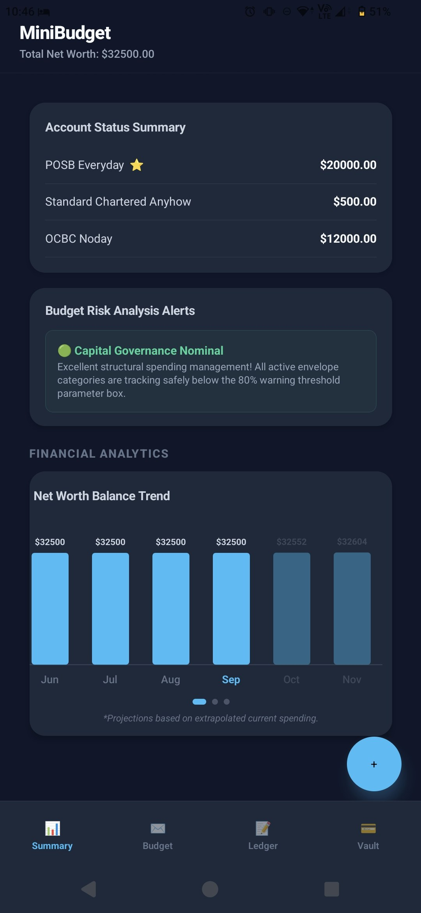
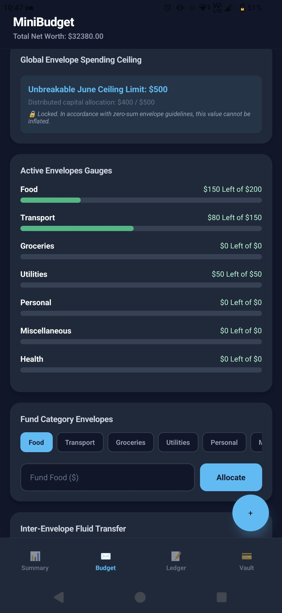
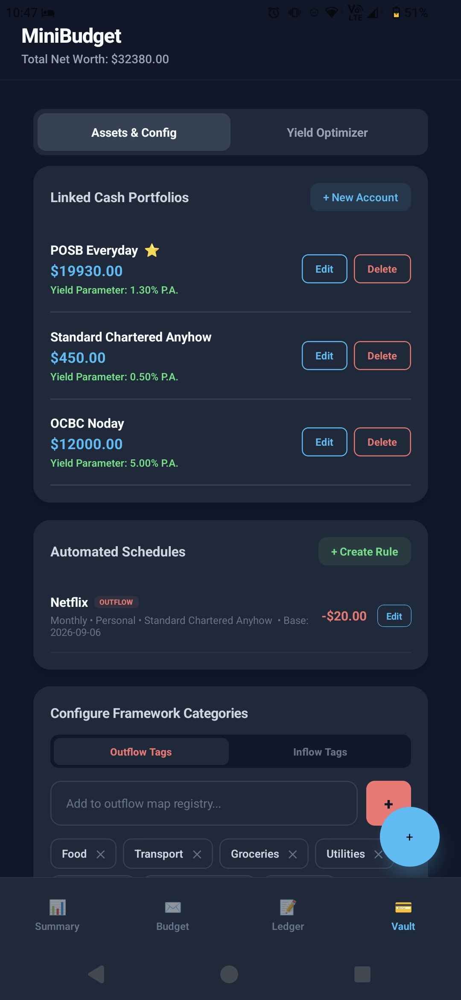
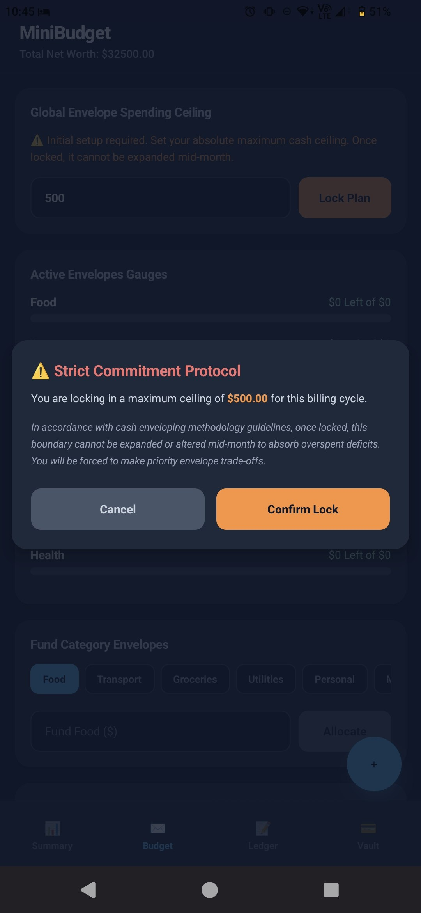
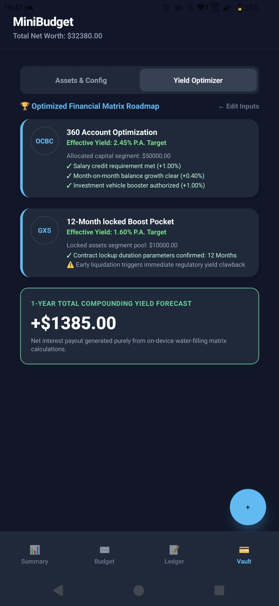
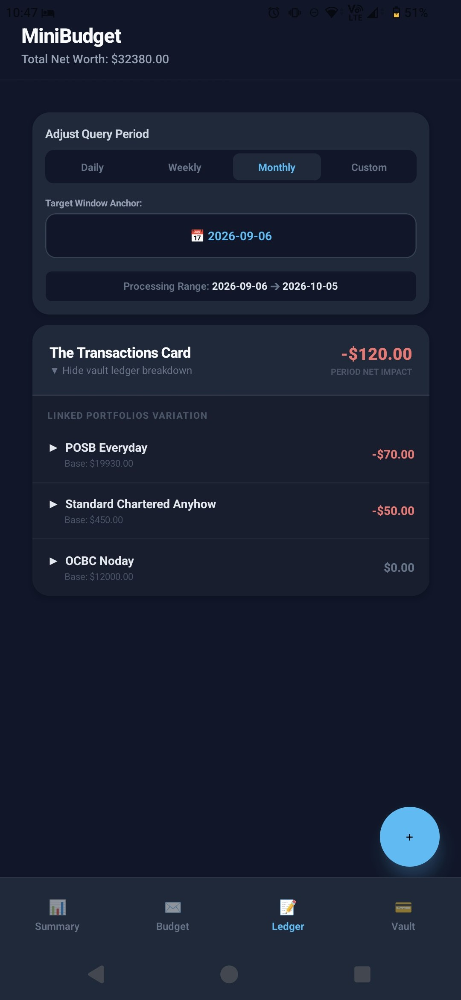
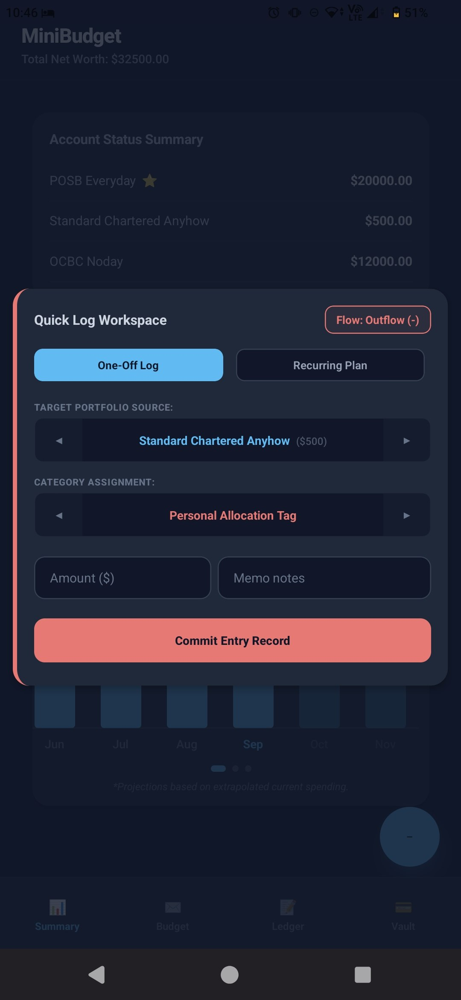

# MiniBudget

A local-first personal finance app that enforces a monthly spending ceiling instead of politely suggesting one. Built with React Native and Expo.

Most budgeting apps let you quietly raise the budget when you overspend. MiniBudget doesn't. Once a month's ceiling is locked it cannot be inflated — overspending has to be absorbed by moving money between envelopes, not by creating more. Every other feature is built around that constraint.

<p align="center">
  
  
  
</p>

---

## Features

### Envelope budgeting with a locked ceiling

Set a monthly spending cap, then distribute it across categories. Allocation is disabled until a ceiling is locked, and locking is deliberately made to feel consequential — a confirmation step spells out that the value cannot be expanded mid-month to absorb a deficit.

Allocations are stored per month and **cannot add up to more than the locked ceiling**; the app rejects any funding that would exceed it. Envelope gauges show remaining balance against allocation. Funds can be moved between envelopes with balance validation, but the global ceiling never moves. The compliance chart only audits months that actually had a locked ceiling.

> The lock is enforced by the app, not cryptographically: it lives in on-device storage, so wiping app data or changing the device date resets it.

<p align="center">
  
</p>

### Yield optimiser

Given available capital, an amount you're willing to lock away, a lock duration, and monthly salary, it places capital across a small set of Singapore savings products and projects a one-year return (simple interest, not compounded).

It models bonus-tier structures rather than a flat headline rate. It is a fixed three-pass allocation, not a general optimiser: OCBC 360 fills first up to its cap, the overflow goes to SCB BonusSaver, and the locked amount is a separate GXS pool. Capital beyond the combined OCBC and SCB caps is reported as unplaced rather than modelled. Each product's result lists which bonuses were applied and which were not:

| Product | Base | Bonus conditions modelled |
|---|---|---|
| OCBC 360 | 0.05% | salary ≥ $1,800 (+1.00%), month-on-month balance growth (+0.40%), investment activity (+1.00%) |
| SC BonusSaver | 0.05% | salary ≥ $3,000 (+0.90%) |
| GXS Boost Pocket | 0.88% | lock duration — 3mo (+0.34%), 4–11mo (+0.52%), 12mo+ (+0.72%) |

The OCBC balance-growth bonus is *assumed* once the balance reaches $3,000, since the app cannot observe month-on-month growth. Locked capital carries a reminder that early withdrawal may forfeit bonus interest.

<p align="center">
  
</p>

### Net worth projection

The summary screen tracks a rolling balance trend with historical months solid and projected months dimmed. The projection applies account interest, average monthly spending and recurring rules; it does not assume any income beyond recurring inflows, so it errs pessimistic. On the Budget screen, each envelope gauge turns amber above 85% consumed and red once overspent.

### Ledger

Transactions are grouped per account in expandable cards. Each shows the account's current balance and the net of its logged inflows and outflows, with amend and delete actions that keep balances consistent. Period-based querying (daily/weekly/monthly/custom windows) is on the roadmap.

<p align="center">
  
</p>

### Recurring automation and account config

Each account carries its own interest rate. On app load the app credits one compounded payout for **every month elapsed** since the account's last interest marker, so missed months are not lost. A rate added to an account that had none starts earning from the current month and never back-fills.

Recurring inflows and outflows are rules with frequency (weekly, bi-weekly, monthly, annual), category, linked account and direction. Each time the app opens it **posts every occurrence that has come due**, dated on its due date, and flags a rule whose account was deleted. A new rule's first posting is one full period after it is created; nothing is back-filled. Spending categories are user-configurable as separate inflow and outflow tag sets rather than hardcoded.

There is no background task: posting and interest happen when the app is opened, using each rule's own due dates, so the numbers are correct whenever you look.

### Quick logging

A floating action button opens a compact entry sheet from any screen — flow direction, account, category, amount, memo — with a toggle to promote the entry into a recurring rule instead of a one-off. A `minibudget://log?amount=12.50&category=Food` deep link stages the same sheet from outside the app; it only pre-fills the entry, and you still commit it yourself.

<p align="center">
  
</p>

### Reconciliation

When a real bank balance drifts from the tracked balance, a reconciliation flow adjusts it and records the correction rather than silently overwriting history.

---

## Architecture

The app runs entirely on-device. No backend, no account, no network call — all financial data stays in `AsyncStorage` on the phone.

```
App.js                      Top-level state + manual tab navigation
├── src/screens/
│   ├── SummaryScreen        Balances, risk alerts, net worth trend, category donut
│   ├── BudgetScreen         Ceiling locking, envelope allocation, transfers, audit
│   ├── TransactionsScreen   Per-account ledger with amend/delete
│   └── Vault/
│       ├── useVaultState.js         Accounts, automations, optimiser inputs
│       └── utils/optimizerEngine.js Fixed three-pass yield allocation
├── src/components/
│   ├── BudgetGraph.js       SVG trend chart (spending + net worth modes)
│   ├── QuickLogModal.js
│   └── ReconciliationModal.js
└── src/utils/               Pure, unit-tested logic (no React)
    ├── validation.js        Strict money / rate / date parsing
    ├── ledger.js            How each transaction type moves a balance
    ├── budget.js            Ceiling-enforced allocation + transfers
    ├── recurring.js         Posting of due recurring rules
    └── interest.js          Month-by-month interest catch-up
```

Persistence is plain `AsyncStorage` written in batches from `App.js`. If the initial load fails, writes are disabled for the session so unreadable data is never overwritten.

**Three decisions worth calling out:**

*No navigation library.* Navigation is four buttons switching a `currentView` value. For a fixed four-tab app this avoids a dependency and a re-render layer; the cost is no navigation stack or back-gesture handling, which this app doesn't need.

*Charts hand-drawn in `react-native-svg`.* The donut chart is stroked arcs computed directly rather than a charting library — smaller bundle, full control over the dark palette.

*Interest and recurring entries applied on load, not on a schedule.* When the app starts it works out which months and due dates have passed since each account's interest marker and each rule's last posted date, and posts them with deterministic ids so a repeat run cannot double-post. No background task, no notification permission, and the numbers are correct whenever you actually look at them.

**Stack:** React Native 0.81 · React 19 · Expo SDK 54 · react-native-svg · AsyncStorage

---

## Running it

```bash
npm install
npx expo start
```

Scan the QR code with Expo Go, or press `a` / `i` for an Android or iOS emulator.

Run the unit tests (no install needed beyond Node 20+):

```bash
npm test
```

---

## Limitations

- Savings rates in the optimiser are **hardcoded and unverified** — they have not been checked against the banks' current terms. Bank bonus structures change frequently; nothing is fetched live and the projections will drift.
- Data is stored unencrypted in the app's private sandbox (AsyncStorage). Android cloud backup is disabled, but there is no app lock or encryption at rest.
- The optimiser is a projection tool, not financial advice. It ignores fees, minimum-balance clawbacks, and the practical friction of actually moving money between banks.
- Data is device-local with no export or backup — clearing app data loses everything.
- Single currency (SGD), single user, no multi-device sync.

## Roadmap

- [ ] Period-based ledger querying (daily / weekly / monthly / custom windows)
- [ ] CSV export / import for backup
- [ ] Configurable rate table so the optimiser survives rate changes
- [ ] Per-category rollover of unspent envelope balances
- [ ] Widen the historical compliance audit beyond four months
